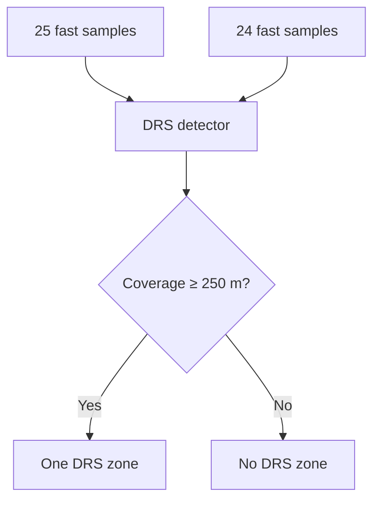

# Qodo feedback on PR #6 (verbatim, fetched from the public GitHub API)

- PR: https://github.com/opelphantom96/agent-factory/pull/6
- Head commit: 0381cf9e1436d906163e079a3ecd3d3b2c1f2b0a
- Fetched: 2026-11-25 13:55 UTC (25 Nov 2026 ~20:56 WIB)
- Sources:
  - https://api.github.com/repos/opelphantom96/agent-factory/issues/6/comments
  - https://api.github.com/repos/opelphantom96/agent-factory/pulls/6/reviews
  - https://api.github.com/repos/opelphantom96/agent-factory/pulls/6/comments
- Note: the `/checks` command was DEPRECATED by Qodo on 1 Oct 2026 and is no longer available.
  Qodo instead auto-posted a PR Summary + Code Review on the PR; that is the feedback below.

## Issue comments (PR conversation)

### comment/review id 7164424483 — @opelphantom96 — created 2026-11-25T13:52:50Z — state: None

```
/checks "https://github.com/opelphantom96/agent-factory/actions/runs/45627768914/job/139252440655"
```

### comment/review id 7164428924 — @qodo-code-review[bot] — created 2026-11-25T13:53:01Z — state: None

```
> [!IMPORTANT]
> The `/checks` command by Qodo was deprecated on the 1st of October 2026 and is no longer available. We recommend switching to the latest Qodo review capabilities. [Learn more](https://docs.qodo.ai/sunsetting-legacy-v1-commands)
```

### comment/review id 7164429047 — @qodo-code-review[bot] — created 2026-11-25T13:53:01Z — state: None

```
<h3>PR Summary by Qodo</h3>

Test the 250 m DRS detection boundary


<code>🧪 Tests</code> <code>🕐 Less than 10 minutes</code>


<details>
<summary>AI Description</summary>

<dl>
<dd>
<br/>

><pre>
>• Add a regression test requiring exactly 250 m of fast samples to produce a DRS zone.
>• Verify that 240 m remains below the detection threshold; the 250 m test currently fails.
></pre>

</dd>
</dl>

</details>

<!-- qodo-describe-risk-slot --><!-- qodo-describe-risk -->
<!-- qodo-describe-risk-start:1795614809.668827057 -->

<details>
<summary>Merge Risk <code>🟢 Low</code></summary>

<dl>
<dd>

<br/>

<details>
<summary>Blast radius <code>🟢 Low</code> <code>💥 0 capabilities</code></summary>

<dl>
<dd>

<br/>

- No production behavior changes identified.


</dd>
</dl>

</details>
<details>
<summary>Behavioral complexity <code>🟢 Low</code> <code>🧩 Assessed behavior</code></summary>

<dl>
<dd>

<br/>

- No production behavior changes identified.


</dd>
</dl>

</details>
<details>
<summary>Potential damage <code>🟢 Low</code> <code>🩹 Assessed behavior</code></summary>

<dl>
<dd>

<br/>

- No production behavior changes identified.


</dd>
</dl>

</details>
<sub>Assessed commit <a href="https://github.com/opelphantom96/agent-factory/commit/0381cf9e1436d906163e079a3ecd3d3b2c1f2b0a">0381cf9</a></sub>


<!-- https://github.com/opelphantom96/agent-factory/commit/0381cf9e1436d906163e079a3ecd3d3b2c1f2b0a -->
</dd>
</dl>
</details>
<!-- /qodo-describe-risk -->

<details>
<summary>Diagram</summary>

<dl>
<dd>

<br/>



</dd>
</dl>

</details>


<details>
<summary>High-Level Assessment</summary>

<dl>
<dd>

<br/>

>Focused boundary tests are appropriate for documenting the defect before changing production behavior. A parameterized test would reduce repetition but would not materially change the approach.

</dd>
</dl>

</details>

<details>
<summary> Files changed (1) <code> +17 / -0 </code> </summary>

<dl>
<dd>

<br/>

<details>
<summary>Tests (1) <code> +17 / -0 </code></summary>

<dl>
<dd>

<details>
<summary>drs.test.js<code>Specify both sides of the 250 m DRS threshold</code> <code>+17/-0</code></summary>

<br/>

>Specify both sides of the 250 m DRS threshold
>
><pre>
>• Adds synthetic fast-sample runs asserting that 25 samples produce a zone from 1000 m to 1250 m, while 24 samples produce none. The 250 m assertion intentionally fails against the unchanged detector.
></pre>
>
><a href='https://github.com/opelphantom96/agent-factory/pull/6/files#diff-dd247b9cf9554ea7118af0185965bb8e43fe94ee964b9d60bc5ed9cf7d86eda5'>src/demo/drs.test.js</a>

</details>

</dd>
</dl>

</details>

</dd>
</dl>

</details>

<!-- qodo-describe-head:0381cf9e1436d906163e079a3ecd3d3b2c1f2b0a -->
```

### comment/review id 7164434888 — @qodo-code-review[bot] — created 2026-11-25T13:53:16Z — state: None

```
<h3>Code Review by Qodo</h3>

<code>🐞 Bugs (2)</code>  <code>📘 Rule violations (0)</code>  <code>📜 Skill insights (0)</code>


<br/>


<details>
<summary>  1.  Red test lands in the shared suite and blocks the verify gate <code>🐞 Bug</code> <code>☼ Reliability</code></summary>

<br/>

> <details open>
><summary>Description</summary>
><br/>
>
><pre>
>The new test at line 29 asserts a 250 m DRS zone that <b><i>detectDrsZones</i></b> (src/demo/features.js:20-33)
>cannot yet produce, because it measures <b><i>end - start</i></b> from first to last sample (240 m for 25
>samples) and drops the zone. Until the T-010 fix lands, <b><i>npm run verify</i></b> stays red for every branch
>that includes this commit, which the factory&#x27;s verify stage needs to pass before it can record a
>verdict.
></pre>
></details>

> <details>
><summary>Code</summary>
><br/>
>
><code>[src/demo/drs.test.js[R29-32]](https://github.com/opelphantom96/agent-factory/pull/6/files#diff-dd247b9cf9554ea7118af0185965bb8e43fe94ee964b9d60bc5ed9cf7d86eda5R29-R32)</code>
>
>```diff
>+test('DRS zone of exactly 250 m coverage is detected (25 samples x 10 m)', () => {
>+  const samples = Array.from({ length: 25 }, (_, i) => ({ distance: 1000 + i * 10, speed: 310 }));
>+  const zones = detectDrsZones(samples);
>+  assert.equal(zones.length, 1, 'expected one DRS zone for 25 samples covering 250 m');
>```
></details>

> <details>
><summary>Evidence</summary>
><br/>
>
><pre>
>The test&#x27;s expectations contradict the current implementation. For 25 samples at 1000..1240 m, the
>loop in detectDrsZones reaches i=24 with fast=true, computes end = 1240, and checks 1240 - 1000 =
>240 &gt;= 250, which is false, so zones is empty and the <b><i>zones.length === 1</i></b> assertion fails. The
>T-009 evidence record shows that the factory&#x27;s verify stage requires all tests to pass (`tests 25,
>pass 25, fail 0`) before a verdict is recorded, so a red test in the suite stops that gate.
></pre>
>
> <code>[src/demo/features.js\[20-33\]](https://github.com/opelphantom96/agent-factory/blob/0381cf9e1436d906163e079a3ecd3d3b2c1f2b0a/src/demo/features.js/#L20-L33)</code>
></details>

> <details>
><summary>Agent prompt</summary>
><br/>
>
>```
>The issue below was found during a code review. Follow the provided context and guidance below and implement a solution
>
>Issue description
>The PR adds a deliberately failing test (`DRS zone of exactly 250 m coverage is detected`) to src/demo/drs.test.js. The test fails because detectDrsZones in src/demo/features.js measures first-to-last sample span, so any test run including this commit is red and the factory verify gate cannot pass.
>
>Fix Focus Areas
>- src/demo/drs.test.js[29-40]
>- src/demo/features.js[20-33]
>
>Recommended Fix
>Either (a) move the failing test to a separate branch or mark it as a known-failing case (for example with the test runner's skip/todo mechanism, with a link to T-010) so the shared verify run stays green, or (b) land the detectDrsZones fix in the same PR, mirroring the T-009 fix (endM = last sample distance + SAMPLE_STEP_M, compare covered length to 250). Document the chosen option in the PR description so the verify gate's expected state is explicit.
>```
> <code>ⓘ Copy this prompt and use it to remediate the issue with your preferred AI generation tools</code>
></details>

[Dismiss ↗](https://app.qodo.ai/findings/5aa5b873-bffe-4372-a61e-72c96207e3b0?action=dismiss&origin=git) | [View ↗](https://app.qodo.ai/findings/5aa5b873-bffe-4372-a61e-72c96207e3b0)

<hr/>
</details>


<br/>


<details>
<summary>  2.  Test comment says DRAFT while the PR is open for review <code>🐞 Bug</code> <code>⚙ Maintainability</code></summary>

<br/>

> <details open>
><summary>Description</summary>
><br/>
>
><pre>
>The comment block above the new tests at lines 24-28 says &#x27;DRAFT — not pushed yet&#x27;, which is false
>once this commit is on the PR branch and open for review. Ticket T-010 is a draft specifically so
>automation does not pick it up, so a reader of the code may conclude the test is unowned or not
>ready when it is actually awaiting review.
></pre>
></details>

> <details>
><summary>Code</summary>
><br/>
>
><code>[src/demo/drs.test.js[R25-28]](https://github.com/opelphantom96/agent-factory/pull/6/files#diff-dd247b9cf9554ea7118af0185965bb8e43fe94ee964b9d60bc5ed9cf7d86eda5R25-R28)</code>
>
>```diff
>+// Day 18 (T-010 draft): boundary test for the same one-step measurement
>+// pattern Qodo flagged in detectBrakingZones (T-009). Each sample covers
>+// one 10 m segment, so 25 fast samples cover 250 m and must be detected;
>+// 24 samples cover only 240 m and must not be. DRAFT — not pushed yet.
>```
></details>

> <details>
><summary>Evidence</summary>
><br/>
>
><pre>
>The comment asserts a state (not pushed) that the PR itself contradicts, because the commit is on
>the PR branch for review. The ticket file marks T-010 as draft and says it is filed so automation
>does not pick it up, so the comment and ticket status now disagree about whether the work is active.
></pre>
>
> <code>[src/demo/drs.test.js\[24-28\]](https://github.com/opelphantom96/agent-factory/blob/0381cf9e1436d906163e079a3ecd3d3b2c1f2b0a/src/demo/drs.test.js/#L24-L28)</code>
></details>

> <details>
><summary>Agent prompt</summary>
><br/>
>
>```
>The issue below was found during a code review. Follow the provided context and guidance below and implement a solution
>
>Issue description
>The comment block at src/demo/drs.test.js lines 24-28 says 'DRAFT - not pushed yet', which no longer matches the state of the PR branch. It also does not say that the test is expected to fail until T-010 is fixed.
>
>Fix Focus Areas
>- src/demo/drs.test.js[24-28]
>
>Recommended Fix
>Replace the 'DRAFT - not pushed yet' wording with a note that the 250 m test is expected to fail until the detectDrsZones measurement fix (ticket T-010) lands, and remove the draft wording.
>```
> <code>ⓘ Copy this prompt and use it to remediate the issue with your preferred AI generation tools</code>
></details>

[Dismiss ↗](https://app.qodo.ai/findings/79b6e420-437a-4992-a7c9-3543c9631448?action=dismiss&origin=git) | [View ↗](https://app.qodo.ai/findings/79b6e420-437a-4992-a7c9-3543c9631448)

<hr/>
</details>


<!-- qodo-self-review-slot -->


<!-- qodo-context:start -->
<details><summary><strong>Context sources</strong></summary>

<div>&#x26A0;&#xFE0F; Tickets: not configured — No jira, linear integration is connected for the linked tickets</div>
<div>Review mode: <code>Auto: 🚀 Fast</code>: Localized boundary tests only; no production behavior or high-risk paths changed.</div>
<!-- qodo-context:end -->
</details>


<!-- qodo-daily-tip:start -->

<details>
<summary><strong>Tip of the day</strong></summary>

<br/>

<pre>💡 Did you know, you can copy the agent prompt from any finding and feed it to your IDE agent</pre>

<a href="https://docs.qodo.ai/tips-and-tricks">More tips ↗</a> | <a href="https://app.qodo.ai/configurations?tab=display-preferences">Customize Qodo ↗</a> | <a href="https://docs.qodo.ai">Qodo docs ↗</a>

</details>


<!-- qodo-daily-tip:end -->


<!-- https://github.com/opelphantom96/agent-factory/commit/0381cf9e1436d906163e079a3ecd3d3b2c1f2b0a -->

<a href="https://www.qodo.ai"></a>
```

## Reviews

### comment/review id 6058865965 — @qodo-code-review[bot] — created 2026-11-25T13:53:17Z — state: COMMENTED

```

```

## Review comments (inline)

### comment/review id 4695896445 — @qodo-code-review[bot] — created 2026-11-25T13:53:18Z — state: None

```


1\. Red test lands in the shared suite and blocks the verify gate <code>🐞 Bug</code> <code>☼ Reliability</code>

<pre>
The new test at line 29 asserts a 250 m DRS zone that <b><i>detectDrsZones</i></b> (src/demo/features.js:20-33)
cannot yet produce, because it measures <b><i>end - start</i></b> from first to last sample (240 m for 25
samples) and drops the zone. Until the T-010 fix lands, <b><i>npm run verify</i></b> stays red for every branch
that includes this commit, which the factory&#x27;s verify stage needs to pass before it can record a
verdict.
</pre>


<details>
<summary><strong>Agent Prompt</strong></summary>

```
Issue description
The PR adds a deliberately failing test (`DRS zone of exactly 250 m coverage is detected`) to src/demo/drs.test.js. The test fails because detectDrsZones in src/demo/features.js measures first-to-last sample span, so any test run including this commit is red and the factory verify gate cannot pass.

Fix Focus Areas
- src/demo/drs.test.js[29-40]
- src/demo/features.js[20-33]

Recommended Fix
Either (a) move the failing test to a separate branch or mark it as a known-failing case (for example with the test runner's skip/todo mechanism, with a link to T-010) so the shared verify run stays green, or (b) land the detectDrsZones fix in the same PR, mirroring the T-009 fix (endM = last sample distance + SAMPLE_STEP_M, compare covered length to 250). Document the chosen option in the PR description so the verify gate's expected state is explicit.
```

<code>ⓘ Copy this prompt and use it to remediate the issue with your preferred AI generation tools</code>
</details>

[Dismiss ↗](https://app.qodo.ai/findings/5aa5b873-bffe-4372-a61e-72c96207e3b0?action=dismiss&origin=git) | [View ↗](https://app.qodo.ai/findings/5aa5b873-bffe-4372-a61e-72c96207e3b0)
```

### comment/review id 4695896494 — @qodo-code-review[bot] — created 2026-11-25T13:53:18Z — state: None

```


2\. Test comment says draft while the pr is open for review <code>🐞 Bug</code> <code>⚙ Maintainability</code>

<pre>
The comment block above the new tests at lines 24-28 says &#x27;DRAFT — not pushed yet&#x27;, which is false
once this commit is on the PR branch and open for review. Ticket T-010 is a draft specifically so
automation does not pick it up, so a reader of the code may conclude the test is unowned or not
ready when it is actually awaiting review.
</pre>


<details>
<summary><strong>Agent Prompt</strong></summary>

```
Issue description
The comment block at src/demo/drs.test.js lines 24-28 says 'DRAFT - not pushed yet', which no longer matches the state of the PR branch. It also does not say that the test is expected to fail until T-010 is fixed.

Fix Focus Areas
- src/demo/drs.test.js[24-28]

Recommended Fix
Replace the 'DRAFT - not pushed yet' wording with a note that the 250 m test is expected to fail until the detectDrsZones measurement fix (ticket T-010) lands, and remove the draft wording.
```

<code>ⓘ Copy this prompt and use it to remediate the issue with your preferred AI generation tools</code>
</details>

[Dismiss ↗](https://app.qodo.ai/findings/79b6e420-437a-4992-a7c9-3543c9631448?action=dismiss&origin=git) | [View ↗](https://app.qodo.ai/findings/79b6e420-437a-4992-a7c9-3543c9631448)
```
